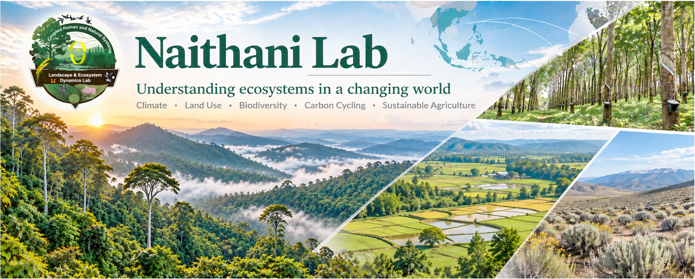

<section class="lab-hero" aria-labelledby="lab-hero-title">

Naithani Lab · University of Arkansas

<h1 id="lab-hero-title">Understanding ecosystems in a changing world</h1>

We study how changing land use and climate affect ecosystem structure, functions, and services. 

<a href="Projects.html">Explore our research</a>
<a href="https://scholar.google.com/citations?user=t1udHZoAAAAJ" target="_blank" rel="noopener noreferrer" class="secondary">Explore our publications ↗</a>
<a href="Positions.html" class="secondary">Join the lab</a>

</section>

<section class="lab-section alt" aria-labelledby="themes-title">

What we study

<h2 id="themes-title">Research across scales</h2>

We integrates ecological observations with statistical, machine learning, and process-based models to understand how biological mechanisms interact with environmental heterogeneity, disturbance, and scale.

<h3>Coupled Human and Natural Systems</h3>
Investigating the dynamic interactions and feedbacks between human activities and natural ecosystems
<a href="Projects.html">Explore research →</a>

<h3>Biodiversity Conservation</h3>
Understanding how land use and environmental disturbances influence biodiversity while developing innovative tools and approaches to assess and monitor biodiversity.
<a href="Projects.html">Explore research →</a>

<h3>Sustainable landscapes</h3>
Connecting ecological knowledge with agriculture, ecosystem services, and long-term landscape sustainability.
<a href="Projects.html">Explore research →</a>

</section>

<section class="lab-section" aria-labelledby="explore-title">

Discover the lab

<h2 id="explore-title">People, Projects, and Pedagogy</h2>

<h3>Projects</h3>
Discover current and past projects, research approaches, and collaborative work.
<a href="Projects.html">View projects →</a>

<h3>People</h3>
Meet the researchers and students who contribute to the lab's work.
<a href="People.html">Meet the lab →</a>

<h3>Teaching &amp; resources</h3>
Explore courses, ecological training, and resources for learning and research.
<a href="Teaching.html">Explore teaching →</a><a href="Resources.html" style="margin-top:12px">Browse resources →</a>

</section>

<section class="lab-section alt" aria-labelledby="connect-title">

Connect with us

<h2 id="connect-title">Collaborate and learn with the Naithani Lab</h2>

We welcome inquiries from students and researchers with overlapping interests. Please review our opportunities page before contacting us about future openings.

<strong>Current opportunities:</strong> There are no open positions through December 2027. See the <a href="Positions.html">Join the Lab page</a> for guidance on future inquiries.

<strong>Contact:</strong> Dr. Kusum Naithani · <a href="mailto:naithanilab1@gmail.com">naithanilab1@gmail.com</a>

</section>

These materials are not endorsed, approved, sponsored, or provided by or on behalf of the University of Arkansas, Fayetteville.

